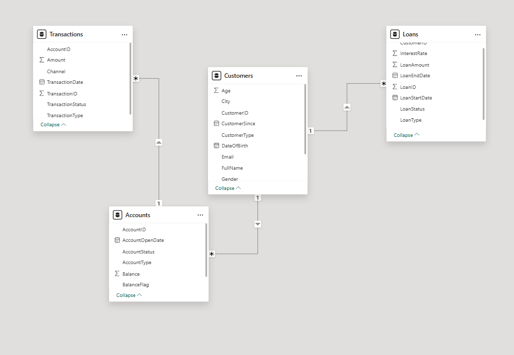
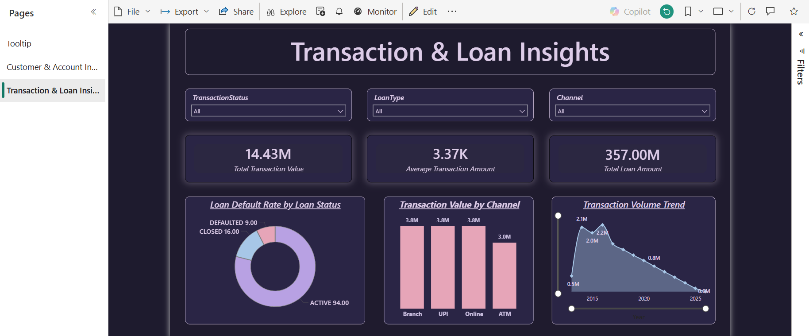
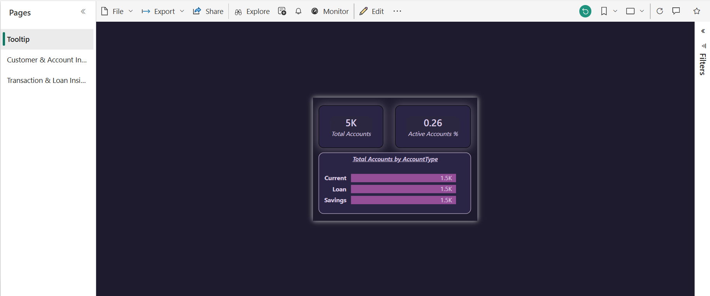

# 💜 AI-Assisted Banking Analytics Dashboard

An end-to-end banking analytics project: **AI-assisted synthetic data** generated in **SQL Server**, modelled and visualised in **Power BI** with DAX measures, tooltip pages and a custom dark-purple theme.

<p align="center">
  
</p>


## 📌 Overview

The project simulates a retail and corporate bank and turns its raw data into insights on customers, accounts, transactions and loans. It covers the full BI workflow:

1. **Generate** a relational banking dataset in SQL Server (with realistic data-quality issues)
2. **Model** the four tables in Power BI with one-to-many relationships
3. **Measure** KPIs with DAX
4. **Visualise** results on a themed, interactive two-page report with a custom tooltip page
5. **Publish** to Power BI Service

---

## 🛠️ Tech Stack

| Layer | Tool |
|---|---|
| Database & data generation | SQL Server (T-SQL) |
| Modelling & reporting | Power BI Desktop |
| Calculations | DAX |
| Sharing | Power BI Service |
| Data generation approach | AI-assisted synthetic data |

---

## 🗄️ Database Design

Database: `BankingDB` (script: [`sql/SQLQuery1.sql`](sql/SQLQuery1.sql))

| Table | Rows | Key columns |
|---|---|---|
| `Customers` | 3,000 | CustomerID, FullName, Gender, DateOfBirth, City, State, CustomerType (Retail / Corporate), CustomerSince, Email, PhoneNumber |
| `Accounts` | 4,500 | AccountID, CustomerID, AccountType (Savings / Current / Loan), AccountOpenDate, AccountStatus, Balance |
| `Transactions` | 10,000 | TransactionID, AccountID, TransactionDate, TransactionType (Credit / Debit), Amount, Channel (ATM / Online / UPI / Branch), TransactionStatus (Success / Failed / Pending) |
| `Loans` | 1,200 | LoanID, CustomerID, LoanType (Home / Personal / Education / Vehicle), LoanAmount, InterestRate, LoanStartDate, LoanEndDate, LoanStatus (Active / Closed / Defaulted) |

Data is produced entirely with set-based T-SQL (CTEs + `ROW_NUMBER()`), so it can be regenerated in seconds.

### 🧹 Intentional data-quality issues

To make the exercise realistic, the generator deliberately seeds messy data that has to be handled before reporting, for example:

- Inconsistent text: extra spaces and mixed casing in names, cities and account status (`'  john   doe '`, `' bengaluru '`, `'ACTIVE '` vs `'active'`)
- Missing values in gender, email, phone and balance
- Invalid values: malformed emails, future dates of birth, negative balances, an extreme `9,999,999` transaction amount
- Referential problems: orphan `AccountID = 999999` in transactions, and transactions dated before the account was opened

---

## 🔗 Data Model

<p align="center">
  
</p>

| Relationship | Cardinality |
|---|---|
| Customers → Accounts | 1 : Many |
| Customers → Loans | 1 : Many |
| Accounts → Transactions | 1 : Many |

Calculated columns such as `Age` (Customers) and `BalanceFlag` (Accounts) support the analysis.

---

## 📊 Dashboard Pages

### 1. Customer & Account Insights
- **Slicers:** CustomerType, AccountType, City
- **KPI cards:** Total Customers, Total Accounts, Average Account Balance
- **Visuals:** Average Account Balance trend over time, Account Status distribution (Active / Dormant / Closed), Dormant Accounts by AccountType

### 2. Transaction & Loan Insights
- **Slicers:** TransactionStatus, LoanType, Channel
- **KPI cards:** Total Transaction Value, Average Transaction Amount, Total Loan Amount
- **Visuals:** Loan Default Rate by Loan Status, Transaction Value by Channel, Transaction Volume trend

<p align="center">
  
</p>

### 3. Tooltip page
A hidden report page shown on hover, giving context-aware detail: **Total Accounts**, **Active Accounts %** and **Total Accounts by AccountType**.

<p align="center">
  
</p>

---

## 📈 KPIs (DAX)

| Area | Measures |
|---|---|
| Customers & Accounts | Total Customers, Total Accounts, Active Accounts %, Average Account Balance, Dormant Accounts |
| Transactions | Total Transaction Value, Average Transaction Amount, Transaction Volume |
| Loans | Total Loan Amount, Loan Default Rate |

All measures respond dynamically to slicers and cross-filtering.

<p align="center">
  <br/>
  
</p>

---

## 🎨 Design

A custom dark-purple / lavender theme keeps the report consistent and easy to read:

- Rounded, glowing KPI cards on a deep indigo background
- Lavender, violet and pink accents with consistent colours across charts
- Large page headers and evenly spaced slicer row
- Page navigation through the report pane

---

## 📂 Repository Structure

```
AI-Assisted-Banking-Analytics-Dashboard/
├── sql/
│   └── SQLQuery1.sql                  # Database, tables and synthetic data generation
├── powerbi/
│   └── Banking_Analytics_Dashboard.pbix
├── screenshots/
│   ├── 1_Tooltip.png
│   ├── 2_Customer_and_Account_Insights.png
│   ├── 3_Transaction_and_Loan_Insights.png
│   ├── 4_Model_view.png
│   ├── 5_KPI_for_Customer_&_Account_Insights.png
│   └── 6_KPI_for_Transaction_&_Loan_Insights.png
├── LICENSE
└── README.md
```

---

## ▶️ How to Run

1. Open SQL Server Management Studio and run `sql/SQLQuery1.sql` to create `BankingDB` and populate all four tables.
2. Open `powerbi/Banking_Analytics_Dashboard.pbix` in Power BI Desktop.
3. If prompted, update the data source to point at your SQL Server instance, then **Refresh**.

> Synthetic data uses `GETDATE()`, so dates shift depending on when the script is run.

---

## 🎯 Key Learnings

- Designing a relational banking schema and generating test data with T-SQL
- Spotting and handling real-world data-quality problems
- Building a star-style data model with 1:Many relationships
- Writing DAX measures that respond to slicers and filters
- Using tooltip pages, themed visuals and consistent UI to make a report executive-ready
- Using AI as a productivity tool for structured data generation

---
